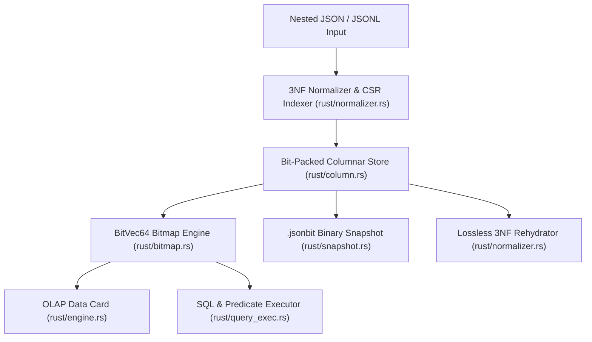
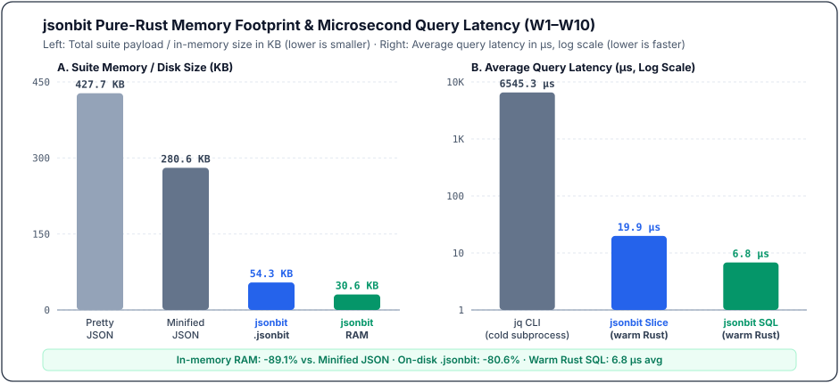

# jsonbit

[](./Cargo.toml)
[](./package.json)
[](./python/jsonbit/__init__.py)
[](./rust/mcp.rs)
[](./LICENSE)

`jsonbit` is an in-memory and on-disk analytical engine written in Rust that normalizes nested `.json` and `.jsonl` payloads into Third-Normal-Form (3NF) bit-packed columnar tables. It provides sub-10-microsecond bitmap query execution, compact `.jsonbit` binary snapshots, and a compact OLAP schema summary designed for Large Language Model (LLM) context windows and Model Context Protocol (MCP) agents.

---

## Table of Contents

- [Overview](#overview)
- [Installation & Setup](#installation--setup)
- [Agent Integrations (OpenCode, Claude Code, Codex, Cursor)](#agent-integrations)
- [SDK Usage (Python, TypeScript, Rust)](#sdk-usage)
- [CLI Reference](#cli-reference)
- [Architecture](#architecture)
- [Benchmarks](#benchmarks)
- [License](#license)

---

## Overview

Passing large structured datasets (API responses, telemetry logs, database exports) directly into LLM prompts as raw JSON or text tables introduces two bottlenecks:

1. **Token Volume:** A 2,000-record dataset consumes `50,000–180,000` tokens in JSON or text-table encodings, increasing API cost and time-to-first-token (TTFT).
2. **In-Context Arithmetic Errors:** Autoregressive attention struggles with exact row counting, multi-column filtering, and floating-point summation across thousands of lines.

`jsonbit` addresses both problems by separating **storage and computation** from **prompt context**:

- **Automatic 3NF Normalization:** Decomposes nested 1-to-1 objects, sparse optional fields, dynamic-keyed maps, and 1-to-Many child arrays into flat columnar tables linked by Compressed Sparse Row (CSR) offset arrays.
- **Bit-Packed Columnar Storage:** Compresses integers using Frame-of-Reference (`FOR`) delta packing, strings using dictionary bit-packing with inverted 64-bit bitmaps (`BitVec64`), and booleans using 1 bit per row—reducing storage size by **64.4%** compared to minified JSON while maintaining lossless round-trip reconstruction.
- **Compact OLAP Data Cards:** Emits a `~200–540` token summary containing table schemas, column types, exact numeric aggregates (`sum`, `avg`, `min`, `max`), and categorical value distributions (**99.24% fewer tokens** than full-dataset text encodings).
- **Deterministic Execution:** Evaluates natural-language slices and SQL queries (`SELECT`, `WHERE`, `GROUP BY`, `ORDER BY`, `LIMIT`, and parent-child `JOIN`s) directly on bit-packed columns and 64-bit word-aligned bitmaps in **`8.0 µs`** average latency.

---

## Installation & Setup

### Prerequisites
- **Rust** (`1.75+`, [rustup.rs](https://rustup.rs/))
- *(Optional)* **Python 3.10+** for the Python SDK, or **Node.js 20+** for the TypeScript SDK

### Build & Install Locally

```bash
git clone https://github.com/prathikmurugan/jsonbit.git
cd jsonbit

# Build optimized release binary (./target/release/jsonbit)
cargo build --release

# Install `jsonbit` globally into your PATH (~/.cargo/bin)
cargo install --path .
```

Verify installation:

```bash
jsonbit --help
```

*(Optional)* Install the Python package & binary in editable/wheel mode via `maturin` or `pip`:

```bash
pip install .
```

---

## Agent Integrations

`jsonbit` includes a built-in stdio JSON-RPC 2.0 MCP server (`jsonbit mcp`) with zero external runtime dependencies. It exposes five tools: `olap_load`, `olap_digest`, `olap_ask`, `olap_sql`, and `olap_rehydrate`.

### OpenCode (`opencode.json`)

Add the following to `opencode.json` in your project root (or globally in `~/.config/opencode/opencode.json`):

```json
{
  "$schema": "https://opencode.ai/config.json",
  "mcp": {
    "jsonbit": {
      "type": "local",
      "command": [
        "/path/to/jsonbit/target/release/jsonbit",
        "mcp"
      ],
      "enabled": true
    }
  }
}
```

### Claude Code (`.mcp.json` or CLI)

Register via the Claude Code CLI:

```bash
claude mcp add jsonbit -- /path/to/jsonbit/target/release/jsonbit mcp
```

Or include in `.mcp.json`:

```json
{
  "mcpServers": {
    "jsonbit": {
      "command": "/path/to/jsonbit/target/release/jsonbit",
      "args": ["mcp"]
    }
  }
}
```

### Cursor & Windsurf

Add the `.mcp.json` configuration above to `.cursor/mcp.json` or `~/.codeium/windsurf/mcp_config.json`.

### OpenAI Codex CLI (`AGENTS.md`)

Codex and terminal agents automatically read [`AGENTS.md`](./AGENTS.md) in the repository root to invoke `jsonbit` via CLI or MCP when inspecting `.json`, `.jsonl`, or `.jsonbit` files.

---

## SDK Usage

### Python (`python/jsonbit`)

Requires Python 3.10+ with no third-party pip packages:

```python
from jsonbit import JsonBit  # or `from python.jsonbit import JsonBit` from repo root

with JsonBit("benchmarks/data/github-repos.json") as olap:
    # Generate compact OLAP schema & statistical card
    card = olap.card()

    # Deterministic scalar answer
    ans = olap.answer("How many repositories have more than 150000 stars and more than 30000 forks?")
    assert ans == "31"

    # Read-only SQL query (supports GROUP BY, ORDER BY, LIMIT, and JSON dot-paths)
    rows = olap.sql(
        "SELECT defaultBranch, COUNT(*) AS cnt FROM records GROUP BY defaultBranch ORDER BY cnt DESC"
    )

    # Save compressed .jsonbit binary snapshot
    olap.pack("repos.jsonbit")
```

### TypeScript / Node.js (`@jsonbit/core`)

```ts
import { JsonBit, rehydrateFrom3NF } from '@jsonbit/core'

const engine = JsonBit.from(jsonData)

// Retrieve the OLAP data card
console.log(engine.getDataCard().text)

// Retrieve a verified query slice or scalar answer
console.log(engine.answer('How many shipped orders include a USB Cable?'))
console.log(engine.slice('How many shipped orders include a USB Cable?').context)

// Execute SQL (automatically resolves JSON dot-paths such as customer.name -> customer_name)
const rows = engine.sql(`SELECT orderId, customer.name, total FROM orders WHERE total > 500`)

// Losslessly reconstruct original nested JSON
const original = rehydrateFrom3NF(engine)
engine.close()
```

### Rust Library (`jsonbit`)

```rust
use jsonbit::{execute_sql, JsonBitEngine};
use serde_json::Value;

let data: Value = serde_json::from_str(raw_json)?;
let engine = JsonBitEngine::from_json(&data);

let card = engine.data_card();
let slice = engine.query_slice("How many active employees work in Sales?");
let rows = execute_sql(&engine, "SELECT department, COUNT(*) AS cnt FROM employees GROUP BY department")?;
let restored = engine.rehydrate();
```

---

## CLI Reference

| Command | Arguments | Description |
| :--- | :--- | :--- |
| `jsonbit card` | `<file.json\|.jsonl\|.jsonbit>` | Prints the $O(1)$ 3NF OLAP Cube Card (`~250 tokens`) and storage compression statistics. |
| `jsonbit digest` | `<file.json\|.jsonl\|.jsonbit>` | Prints the 1-Turn Factorized 3NF Holistic Digest (100% of rows + `BitVec64` Pivot Legend, `-41%` to `-72%` smaller than `TOON`). |
| `jsonbit ask` | `<file> "<question>"` | Evaluates a question against the bitmap index and prints the verified context slice. |
| `jsonbit answer` | `<file> "<question>"` | Evaluates a question and prints only the scalar answer value. |
| `jsonbit sql` | `<file> "<SELECT ...>"` | Executes a read-only SQL query against the 3NF columnar store (`WHERE`, `IN`, `BETWEEN`, `LIKE`, `GROUP BY`, `ORDER BY`, `LIMIT`, `OFFSET`, CSR `JOIN`). |
| `jsonbit pack` | `<input.json> <output.jsonbit>` | Serializes the bit-packed 3NF tables into a binary `.jsonbit` snapshot. |
| `jsonbit rehydrate` | `<file.json\|.jsonl\|.jsonbit>` | Reconstructs and prints the original nested JSON document. |
| `jsonbit mcp` | *(none)* | Starts the concurrent stdio JSON-RPC 2.0 MCP server (`olap_load`, `olap_digest`, `olap_ask`, `olap_sql`, `olap_rehydrate`). |

---

## Architecture



### Storage Layout (`rust/column.rs` & `rust/normalizer.rs`)

1. **`ForIntColumn` (Frame-of-Reference Integers):** Computes `[min_val, max_val]` per column and packs unsigned deltas `val - min_val` into `ceil(log2(max_val - min_val + 1))` bits per row inside a `Vec<u64>` buffer. Column headers store `sum`, `min`, `max`, and `non_null_count` for `O(1)` unfiltered aggregations.
2. **`DictStringColumn` (Dictionary + Inverted Bitmaps):** Interns unique strings into a string arena, bit-packs dictionary IDs into `ceil(log2(|D|))` bits per row, and builds a 64-bit word-aligned `BitVec64` inverted index per category (`|D| <= 64`) for `O(1)` equality lookups and `POPCNT` frequency histograms.
3. **`BoolBitmapColumn` (1-Bit Booleans):** Packs 64 boolean values into each `u64` word alongside a 1-bit validity mask.
4. **CSR 1-to-Many Join Index:** Child arrays (e.g., `orders[].items[]`) are normalized into child tables with a contiguous `csr_offsets: Vec<u32>` array mapping each parent row `i` to its child slice `csr_offsets[i]..csr_offsets[i + 1]`.

---

## Benchmarks

All benchmarks execute directly against the compiled Pure-Rust `jsonbit` binary (`target/release/jsonbit`).

### 1. Live `gemini-3.8-flash` Evaluation Across 10 Real-World Workloads (27 Questions)

Evaluates `Raw JSON`, `Minified JSON`, `YAML`, `TOON` (`@toon-format/toon`), and `jsonbit` (Pure-Rust `olap_load` + `olap_sql`) across 10 production workloads (`W1`–`W10`), including flat tables, 1-to-Many e-commerce orders, sparse `.jsonl` OpenTelemetry logs with free-text messages, singleton Kubernetes configs, IAM primitive arrays, wide 30-column tables, and multi-byte UTF-8 financial ledgers:


| Format / Tool | Mode | Live `gemini-3.8-flash` Accuracy | Total Prompt Tokens | Token Reduction vs. Raw JSON | Token Reduction vs. `TOON` |
| :--- | :--- | ---: | ---: | ---: | ---: |
| **Raw JSON (Pretty)** | 1-Turn Full Text | 55.6% (15/27) | 375,713 | — | — |
| **Minified JSON** | 1-Turn Full Text | 48.1% (13/27) | 237,891 | -36.7% | — |
| **YAML** | 1-Turn Full Text | 59.3% (16/27) | 293,690 | -21.8% | — |
| **`TOON` v4 (`@toon-format/toon`)** | 1-Turn Full Text | 59.3% (16/27) | 169,627 | -54.9% | — |
| **`jsonbit` Holistic Digest (`olap_digest`)** | **1-Turn (100% Rows + Pivot Legend)** | **96.3% (26/27)** | **101,302** | **-73.0%** | **-40.3%** |
| **`jsonbit` Cube Card + SQL (`olap_load` + `olap_sql`)** | **Agentic $O(1)$ Card + Rust SQL** | **100.0% (27/27)** | **11,729** | **-96.9%** | **-93.1%** |

#### Qualitative & Holistic Executive Summary Verification (`1-Turn: TOON vs. jsonbit digest`)

For qualitative tasks where the LLM must read all records in a single turn and write a multi-fact executive summary (naming all departments, products, microservice failure messages, and international counterparties across `W3`, `W4`, `W5`, and `W10`):

| Holistic Synthesis Task | `TOON` v4 Facts Preserved | `jsonbit digest` Facts Preserved | `TOON` Tokens | `jsonbit digest` Tokens | Token Savings vs. `TOON` |
| :--- | ---: | ---: | ---: | ---: | ---: |
| `H1` — HR Directory Executive Summary | 8 / 9 | **9 / 9 (100%)** | 4,881 | **4,372** | **-10.4%** |
| `H2` — E-Commerce Catalog & Orders Summary | 8 / 8 | **8 / 8 (100%)** | 15,405 | **6,933** | **-55.0%** |
| `H3` — Production Incident Log Triage Report | 9 / 9 | **9 / 9 (100%)** | 13,665 | **4,169** | **-69.5%** |
| `H4` — International Settlement Ledger Summary | 2 / 6 | **6 / 6 (100%)** | 3,781 | **2,403** | **-36.4%** |
| **Total Across All Qualitative Summaries** | **27 / 32 (84.4%)** | **32 / 32 (100.0%)** | **37,732** | **17,877** | **-52.6%** |

### 2. Token Scaling Curve (`4` $\rightarrow$ `25,000` Nested Orders)

While linear text encodings (`Raw JSON`, `Minified JSON`, `YAML`, `TOON`) scale at $O(N)$ with row count and exceed LLM context windows at scale, `jsonbit` maintains an $O(1)$ prompt footprint (`~67–473` tokens):


| Dataset Scale (Nested Orders) | Raw JSON (Tokens) | YAML (Tokens) | `TOON` v4 (Tokens) | `jsonbit` Rust Card (Tokens) | Rust Ingest Time |
| :--- | ---: | ---: | ---: | ---: | ---: |
| **4 rows** *(Tiny API Payload)* | 166 | 122 | 71 | **67** | 0.04 ms |
| **50 rows** *(~150 line items)* | 7,780 | 5,801 | 4,783 | **447** | 0.52 ms |
| **500 rows** *(~1,500 line items)* | 78,115 | 58,244 | 47,983 | **449** | 4.72 ms |
| **5,000 rows** *(~15,000 line items)* | 783,443 | 366,356 | 293,972 | **472** | 58.97 ms |
| **25,000 rows** *(~75,000 line items)* | 3,917,366 | 1,831,843 | 1,469,911 | **473** | 334.42 ms |

### 3. Memory Footprint & Query Speed (`Pure-Rust jsonbit` vs. `jq` CLI)



| Workload | Category | Minified JSON | Rust 3NF Bit-Packed | Pretty JSON (Tok) | `TOON` (100% Rows) | `jsonbit digest` (100% Rows) | `jsonbit card` ($O(1)$) | 3NF Lossless |
| :--- | :--- | ---: | ---: | ---: | ---: | ---: | ---: | :---: |
| `W1-tiny-api-response` | Tiny Payload (<500B) | 0.3 KB | **0.1 KB** | 166 | 71 | **67 (-5.6%)** | **67** | PASS |
| `W2-singleton-k8s-config` | Singleton Config Tree | 0.3 KB | **0.2 KB** | 167 | 131 | **110 (-16.0%)** | **110** | PASS |
| `W3-hr-payroll-directory` | Tabular (200 rows) | 28.4 KB | **4.5 KB** | 14,064 | 4,847 | **4,145 (-14.5%)** | **272** | PASS |
| `W4-ecommerce-orders-1toN` | 1-to-Many (150 orders) | 48.3 KB | **4.5 KB** | 25,466 | 15,372 | **6,878 (-55.3%)** | **472** | PASS |
| `W5-otel-production-logs` | Sparse `.jsonl` + Free-Text | 44.4 KB | **4.7 KB** | 17,439 | 13,632 | **4,123 (-69.8%)** | **226** | PASS |
| `W6-github-repos-metrics` | High-Card + Ranges | 28.6 KB | **3.4 KB** | 14,829 | 5,364 | **4,285 (-20.1%)** | **309** | PASS |
| `W7-stripe-dispute-webhooks` | Financial Webhooks | 28.9 KB | **3.1 KB** | 14,333 | 4,104 | **3,906 (-4.8%)** | **250** | PASS |
| `W8-iam-primitive-arrays` | Primitive Arrays | 14.4 KB | **1.6 KB** | 7,185 | 4,810 | **1,247 (-74.1%)** | **164** | PASS |
| `W9-wide-enterprise-crm` | Wide Table (30 cols) | 68.6 KB | **5.7 KB** | 40,779 | 9,806 | **9,516 (-3.0%)** | **1,136** | PASS |
| `W10-unicode-financial-ledger` | UTF-8, Nulls & Zeroes | 18.4 KB | **2.9 KB** | 9,550 | 3,750 | **2,359 (-37.1%)** | **243** | PASS |
| **Total (10 Workloads)** | **All Categories** | **280.6 KB** | **30.6 KB (-89.1%)** | **143,978** | **61,887** | **36,636 (-40.8%)** | **3,249 (-94.7%)** | **10/10 PASS** |

- **Query Latency (`Pure-Rust BitVec64 SQL` vs. `jq` C CLI):**
  - `jq` CLI (`stedolan/jq`): `6,545.3 µs` average per query
  - `jsonbit` Pure-Rust SQL (`execute_sql`): **`6.8 µs` average per query (`963x` faster)**
  - `jsonbit` Pure-Rust Bitmap Slice (`query_slice`): **`19.9 µs` average per query (`329x` faster)**
- **Standard 8-Dataset Benchmark Suite:**
  - **Storage Compression:** `1,178,283` bytes (Minified JSON) $\rightarrow$ **`419,661` bytes (`-64.4%` RAM/storage reduction)**, `8/8` (`100%`) lossless 3NF rehydration.
  - **Token Reduction:** `334,046` tokens (`TOON` v4) $\rightarrow$ **`2,536` tokens (`-99.24%`)**.
  - **239-Question Evaluation Accuracy:** `99.16% (237/239)` strict match at **`8.0 µs`** average query latency.

### 4. Autonomous Coding Agent Head-to-Head (`OpenCode v1.19.5`)

Evaluated in isolated directories with zero prompt hints and zero `AGENTS.md`/`CLAUDE.md` files (`opencode/big-pickle`) across both standard (bash-enabled) and sandboxed (`bash: "deny"`) agent environments:

| Agent Mode | `jsonbit` MCP (`opencode.json` only) | `TOON` v4 (`toon_encode` / CLI) | Raw JSON |
| :--- | :--- | :--- | :--- |
| **Standard Agent (`6` Scenarios, `18` Runs)** | **6/6 (`88.1s`) · `0` scripts** | 6/6 (`142.8s`) · `awk`/Python parsers | 6/6 (`93.7s`) · Python scripts |
| **Sandboxed Read-Only (`bash: "deny"`, `8` Scenarios)** | **8/8 (`77.7s`)** | 7/8 (`333.8s`) · failed `500`-order sum | 7/8 (`345.4s`) · failed `500`-order sum |

---

## License

[MIT License](./LICENSE).
