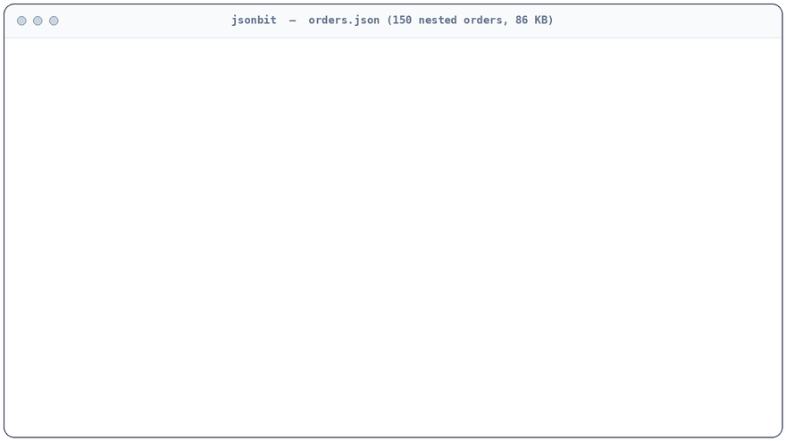
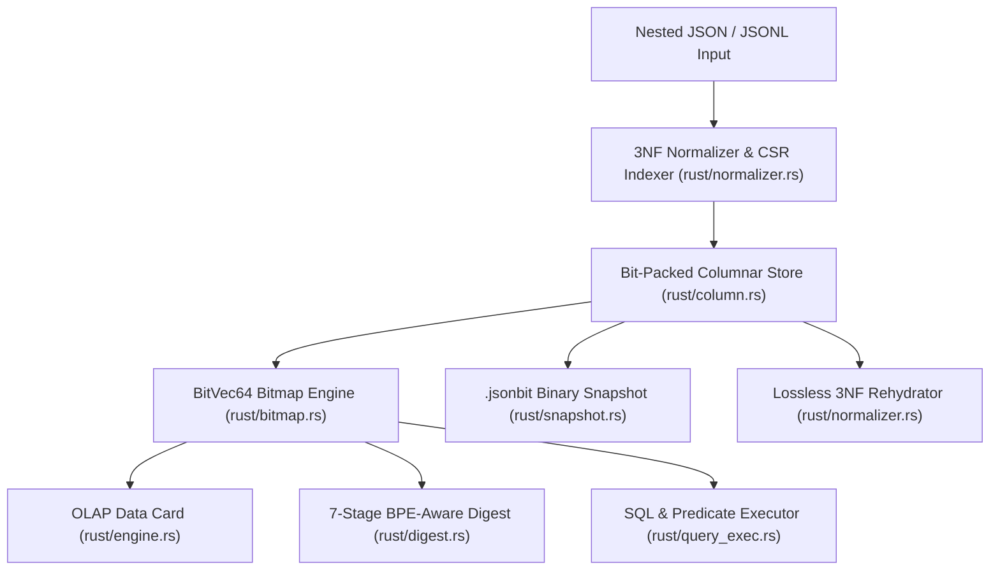

# jsonbit

[](https://github.com/prathikmurugan/jsonbit/actions/workflows/ci.yml)
[](https://crates.io/crates/jsonbit)
[](https://pypi.org/project/jsonbit/)
[](https://www.npmjs.com/package/@jsonbit/core)
[](./rust/mcp.rs)
[](./LICENSE)

**Your agent is burning tokens reading a 5 MB JSON file. Give it a ~470-token schema card and a SQL tool instead.**

**95.1% fewer estimated tokens** vs. minified JSON with **27/27 accuracy** in agentic SQL/MCP mode — or **62.0% fewer tokens than `TOON`** (**83.7% fewer than Pretty JSON**, winning 10/10 workloads) in 100%-row single-prompt `digest` mode ([Benchmarks](#benchmarks)).



```bash
pip install jsonbit
jsonbit digest path/to/your-file.json
```

Pass the output to your LLM in place of the raw JSON — or connect `jsonbit mcp` to let your agent query locally via SQL. *(Rust `cargo`, Node.js `npm`/`npx`, and standalone binaries are listed under [Installation & Setup](#installation--setup).)*

| Workflow | Command / MCP Tool | Best For | Fidelity & Guarantees |
| :--- | :--- | :--- | :--- |
| **1-Turn Compaction** | `jsonbit digest` / `olap_digest` | Single-prompt LLM calls & holistic summaries where the model needs every row. | Compact LLM text view containing all rows, escaped delimiters, hoisted child tables, and precomputed stats *(rounded averages are approximate)*. |
| **Agentic Local Querying** | `jsonbit card` + `sql` / `olap_load` + `olap_sql` | Coding agents (OpenCode, Claude Code, Cursor) querying medium/large `.json` or `.jsonl` files. | Emits a compact schema and statistics summary (independent of row count); runs exact read-only SQL & `BitVec64` filters locally in microseconds. |
| **Binary Storage** | `jsonbit pack` / `jsonbit rehydrate` | Archiving or caching normalized `.jsonbit` snapshots on disk (`-80.6%` vs. minified JSON on `W1`–`W10`). | Lossless round-trip verified across all 33 benchmark/adversarial datasets and unit tests (preserving nulls, colliding keys, and `u64 > i64::MAX`). |

---

## Table of Contents

- [Installation & Setup](#installation--setup)
- [Agent Integrations (OpenCode, Claude Code, Codex, Cursor)](#agent-integrations)
- [CLI Reference](#cli-reference)
- [Benchmarks](#benchmarks)
- [Architecture](#architecture)
- [License](#license)

---

## Installation & Setup

Install the pre-built native `jsonbit` binary using your preferred package manager (no Rust compiler required for Python or Node.js):

### Python (`pip` / `uv`) — *Includes native CLI + Python SDK*
```bash
pip install jsonbit
```

### Rust (`cargo`)
```bash
cargo install jsonbit
```

### Node.js (`npm` / `npx`) — *Includes native CLI + TypeScript SDK*
```bash
npm install -g @jsonbit/core
# or run directly without global install:
npx @jsonbit/core --help
```

### Pre-Built Binaries & Building from Source
Standalone binaries for Linux (`x64`, `arm64`), macOS (`arm64`, `x64`), and Windows (`x64`) are attached to every [GitHub Release](https://github.com/prathikmurugan/jsonbit/releases).

To build from source (requires Rust `1.75+`):
```bash
git clone https://github.com/prathikmurugan/jsonbit.git
cd jsonbit
cargo install --path .
```

Verify installation:
```bash
jsonbit --version
```

---

## Agent Integrations

`jsonbit` includes a built-in stdio JSON-RPC 2.0 MCP server (`jsonbit mcp`) with zero external runtime dependencies. It exposes five tools: `olap_load`, `olap_digest`, `olap_ask`, `olap_sql`, and `olap_rehydrate`.

### OpenCode (`opencode.json`)

Add the following to `opencode.json` in your project root (or globally in `~/.config/opencode/opencode.json`):

```json
{
  "$schema": "https://opencode.ai/config.json",
  "mcp": {
    "jsonbit": {
      "type": "local",
      "command": ["jsonbit", "mcp"],
      "enabled": true
    }
  }
}
```

### Claude Code (`.mcp.json` or CLI)

Register via the Claude Code CLI:

```bash
claude mcp add jsonbit -- jsonbit mcp
```

Or include in `.mcp.json`:

```json
{
  "mcpServers": {
    "jsonbit": {
      "command": "jsonbit",
      "args": ["mcp"]
    }
  }
}
```

### Cursor & Windsurf

Add the `.mcp.json` configuration above to `.cursor/mcp.json` or `~/.codeium/windsurf/mcp_config.json`.

### OpenAI Codex CLI (`AGENTS.md`)

Codex and terminal agents automatically read [`AGENTS.md`](./AGENTS.md) in the repository root to invoke `jsonbit` via CLI or MCP when inspecting `.json`, `.jsonl`, or `.jsonbit` files.

---

## CLI Reference

| Command | Arguments | Description |
| :--- | :--- | :--- |
| `jsonbit card` | `<file.json\|.jsonl\|.jsonbit>` | Prints the compact 3NF schema and statistics summary (independent of row count) plus storage compression stats. |
| `jsonbit digest` | `<file.json\|.jsonl\|.jsonbit>` | Prints the 1-Turn Factorized 3NF Holistic Digest (all rows, hoisted child tables, and precomputed summary stats). |
| `jsonbit ask` | `<file> "<question>"` | Evaluates a question against the bitmap index and prints the verified context slice. |
| `jsonbit answer` | `<file> "<question>"` | Evaluates a question and prints only the scalar answer value. |
| `jsonbit sql` | `<file> "<SELECT ...>"` | Executes a read-only SQL query against the 3NF columnar store (`WHERE`, `IN`, `BETWEEN`, `LIKE`, `GROUP BY`, `ORDER BY`, `LIMIT`, `OFFSET`, CSR `JOIN`). |
| `jsonbit pack` | `<input.json> <output.jsonbit>` | Serializes the bit-packed 3NF tables into a binary `.jsonbit` snapshot. |
| `jsonbit rehydrate` | `<file.json\|.jsonl\|.jsonbit>` | Reconstructs and prints the original nested JSON document. |
| `jsonbit mcp` | *(none)* | Starts the concurrent stdio JSON-RPC 2.0 MCP server (`olap_load`, `olap_digest`, `olap_ask`, `olap_sql`, `olap_rehydrate`). |

<details>
<summary><strong>Programmatic SDK Usage (Python, TypeScript, Rust)</strong></summary>

#### Python (`pip install jsonbit`)
```python
from jsonbit import JsonBit

with JsonBit("benchmarks/data/github-repos.json") as olap:
    card = olap.card()
    ans = olap.answer("How many repositories have more than 150000 stars and more than 30000 forks?")
    rows = olap.sql("SELECT defaultBranch, COUNT(*) AS cnt FROM records GROUP BY defaultBranch ORDER BY cnt DESC")
    olap.pack("repos.jsonbit")
```

#### TypeScript / Node.js (`@jsonbit/core`)
```ts
import { JsonBit, rehydrateFrom3NF } from '@jsonbit/core'

const engine = JsonBit.from(jsonData)
const card = engine.getDataCard().text
const rows = engine.sql(`SELECT orderId, customer.name, total FROM orders WHERE total > 500`)
const original = rehydrateFrom3NF(engine)
engine.close()
```

#### Rust Library (`cargo add jsonbit`)
```rust
use jsonbit::{execute_sql, JsonBitEngine};

let engine = JsonBitEngine::from_json(&serde_json::from_str(raw_json)?);
let card = engine.data_card();
let rows = execute_sql(&engine, "SELECT department, COUNT(*) AS cnt FROM employees GROUP BY department")?;
let restored = engine.rehydrate();
```

</details>

---

## Benchmarks

All benchmarks run directly against the compiled Pure-Rust binary (`target/release/jsonbit`). Token counts use `gpt-tokenizer` (`o200k_base`) for reproducible cross-format comparison.

### At a Glance

| Workflow | Headline Result | Measured Scope |
| :--- | :--- | :--- |
| **Agentic SQL (`card` + `sql`)** | **100.0% accuracy (27/27)** · **-95.1% tokens** vs. Minified JSON | Live `gemini-3.8-flash` across 10 workloads (`W1`–`W10`) |
| **1-Turn Digest (`digest`)** | **-83.7% tokens** vs. Pretty JSON (`-62.0%` vs. `TOON`, 10/10 wins) | 100% lossless full-row compaction on `W1`–`W10` (`23,513` vs. `143,978` tok) |
| **Coding Agents (`mcp`)** | **10/10 (`153.2s`)** vs. **2/10 (`735.0s`)** on Raw JSON | Sandboxed `OpenCode v1.19.5` (`bash: "deny"`, up to 15k-row logs) |
| **Storage & Speed (`pack` / `sql`)** | **-89.1% RAM** · **-80.6% disk** · **6.8 µs** avg warm SQL query | `W1`–`W10` bit-packed 3NF store, 100% lossless round-trip |

---

### 1. Live LLM Accuracy & Token Efficiency (`gemini-3.8-flash`, 27 Questions)

Evaluated across 10 production workloads (`W1`–`W10`: flat tables, 1-to-Many orders, sparse `.jsonl` OpenTelemetry logs, singleton Kubernetes configs, IAM arrays, 30-column tables, and UTF-8 ledgers):


| Format / Tool | Workflow Mode | Accuracy | Est. Tokens (`o200k_base`) | vs. Minified JSON | vs. Raw JSON |
| :--- | :--- | ---: | ---: | ---: | ---: |
| **Raw JSON (Pretty)** | 1-Turn Full Text | 55.6% (15/27) | 375,713 | +57.9% | — |
| **Minified JSON** | 1-Turn Full Text | 48.1% (13/27) | 237,891 | — | -36.7% |
| **YAML** | 1-Turn Full Text | 59.3% (16/27) | 293,690 | +23.5% | -21.8% |
| **`TOON` v4** | 1-Turn Full Text | 59.3% (16/27) | 169,627 | -28.7% | -54.9% |
| **`jsonbit digest`** | **1-Turn (All Rows + Stats)** | **96.3% (26/27)** | **101,302** | **-57.4%** | **-73.0%** |
| **`jsonbit card + sql`** | **Agentic Schema Card + Local Rust SQL** | **100.0% (27/27)** | **11,729** | **-95.1%** | **-96.9%** |

> *Note: The `jsonbit card + sql` total includes both the schema card prompt and generated SQL query tokens. `jsonbit digest` was evaluated on the `v1.1.5` digest encoder; the current 7-stage BPE-aware `digest` cuts full-row token counts a further `-32.3%` (see Section 4).*

<details>
<summary><strong>Single-Prompt Qualitative Summary Accuracy (H1–H4: 32/32 facts preserved)</strong></summary>

For qualitative tasks where the LLM reads every record in 1 turn and writes a multi-fact executive summary across `W3`, `W4`, `W5`, and `W10`:

| Task | `TOON` v4 Facts | `jsonbit digest` Facts | `TOON` Tokens | `jsonbit digest` Tokens | Savings vs. `TOON` |
| :--- | ---: | ---: | ---: | ---: | ---: |
| `H1` — HR Directory Summary | 8 / 9 | **9 / 9 (100%)** | 4,881 | **4,372** | **-10.4%** |
| `H2` — E-Commerce Catalog & Orders | 8 / 8 | **8 / 8 (100%)** | 15,405 | **6,933** | **-55.0%** |
| `H3` — Incident Log Triage Report | 9 / 9 | **9 / 9 (100%)** | 13,665 | **4,169** | **-69.5%** |
| `H4` — International Settlement Ledger | 2 / 6 | **6 / 6 (100%)** | 3,781 | **2,403** | **-36.4%** |
| **Total** | **27 / 32 (84.4%)** | **32 / 32 (100.0%)** | **37,732** | **17,877** | **-52.6%** |

</details>

---

### 2. Token Scaling at Scale (`4` $\rightarrow$ `25,000` Nested Orders)

Linear text formats scale at $O(N)$ and overflow LLM context windows; `jsonbit card` stays constant at $O(1)$ (`~67–471` tokens):


| Dataset Scale (Nested Orders) | Raw JSON | YAML | `TOON` v4 | `jsonbit card` ($O(1)$) | Rust Ingest |
| :--- | ---: | ---: | ---: | ---: | ---: |
| **4 rows** *(Tiny API Payload)* | 166 | 122 | 71 | **67** | 0.04 ms |
| **50 rows** *(~150 line items)* | 7,780 | 5,801 | 4,783 | **445** | 0.51 ms |
| **500 rows** *(~1,500 line items)* | 78,115 | 58,244 | 47,983 | **447** | 3.99 ms |
| **5,000 rows** *(~15,000 line items)* | 783,443 | 366,356 | 293,972 | **470** | 55.56 ms |
| **25,000 rows** *(~75,000 line items)* | 3,917,366 | 1,831,843 | 1,469,911 | **471** | 315.13 ms |

> *Note: At `5,000` and `25,000` rows (>2 MB), `YAML` and `TOON` counts are ratio-extrapolated from the `500`-row exact encoding; `jsonbit card` tokens and Rust ingest times are measured directly on the full dataset.*

---

### 3. Autonomous Coding Agents (`OpenCode v1.19.5`)

Evaluated in isolated directories with zero prompt hints and zero `AGENTS.md`/`CLAUDE.md` files (`opencode/big-pickle`):

| Environment & Suite | `jsonbit` MCP (`opencode.json` only) | `TOON` v4 | Raw JSON |
| :--- | :--- | :--- | :--- |
| **Standard Agent** (`6` scenarios, `18` runs) | **6/6 (`88.1s`) · `0` scripts** | 6/6 (`142.8s`) | 6/6 (`93.7s`) |
| **Sandboxed Read-Only** (`bash: "deny"`, `8` scenarios) | **8/8 (`77.7s`)** | 7/8 (`333.8s`) | 7/8 (`345.4s`) |
| **Hard Scale & Log Triage** (`bash: "deny"`, `10` scenarios, `30` runs, up to `15k` rows) | **10/10 (`153.2s`)** | 3/10 (`796.9s`) | 2/10 (`735.0s`) |

---

### 4. Memory Footprint, Query Speed & Per-Workload Results (`W1`–`W10`)


- **In-memory 3NF column store:** `280.6 KB` (Minified JSON) $\rightarrow$ **`30.6 KB` (`-89.1%`)**
- **On-disk `.jsonbit` snapshots (`jsonbit pack`):** `280.6 KB` (Minified) / `427.7 KB` (Raw) $\rightarrow$ **`54.3 KB` (`-80.6%` / `-87.3%`)**
- **Query latency:** `6,545.3 µs` (`jq` CLI cold subprocess) vs. **`6.8 µs`** (`jsonbit` warm Rust SQL) and **`19.9 µs`** (`jsonbit` warm Rust bitmap slice)

<details>
<summary><strong>Per-Workload Breakdown (W1–W10 + Real-World GitHub API JSON + 8-Dataset Suite)</strong></summary>

| Workload | Category | Minified | Rust RAM | Pretty JSON (Tok) | `TOON` (100% Rows) | `jsonbit digest` (100% Rows) | `jsonbit card` ($O(1)$) | Lossless |
| :--- | :--- | ---: | ---: | ---: | ---: | ---: | ---: | :---: |
| `W1-tiny-api-response` | Tiny Payload (<500B) | 0.3 KB | **0.1 KB** | 166 | 71 | **67 (-5.6%)** | **67** | PASS |
| `W2-singleton-k8s-config` | Singleton Config Tree | 0.3 KB | **0.2 KB** | 167 | 131 | **110 (-16.0%)** | **110** | PASS |
| `W3-hr-payroll-directory` | Tabular (200 rows) | 28.4 KB | **4.5 KB** | 14,064 | 4,847 | **2,312 (-52.3%)** | **270** | PASS |
| `W4-ecommerce-orders-1toN` | 1-to-Many (150 orders) | 48.3 KB | **4.5 KB** | 25,466 | 15,372 | **4,573 (-70.3%)** | **470** | PASS |
| `W5-otel-production-logs` | Sparse `.jsonl` Logs | 44.4 KB | **4.7 KB** | 17,439 | 13,632 | **2,517 (-81.5%)** | **224** | PASS |
| `W6-github-repos-metrics` | High-Card + Ranges | 28.6 KB | **3.4 KB** | 14,829 | 5,364 | **3,218 (-40.0%)** | **307** | PASS |
| `W7-stripe-dispute-webhooks` | Financial Webhooks | 28.9 KB | **3.1 KB** | 14,333 | 4,104 | **1,378 (-66.4%)** | **248** | PASS |
| `W8-iam-primitive-arrays` | Primitive Arrays | 14.4 KB | **1.6 KB** | 7,185 | 4,810 | **914 (-81.0%)** | **162** | PASS |
| `W9-wide-enterprise-crm` | Wide Table (30 cols) | 68.6 KB | **5.7 KB** | 40,779 | 9,806 | **6,654 (-32.1%)** | **1,134** | PASS |
| `W10-unicode-financial-ledger` | UTF-8, Nulls & Zeroes | 18.4 KB | **2.9 KB** | 9,550 | 3,750 | **1,770 (-52.8%)** | **241** | PASS |
| **Total (W1–W10)** | **All Categories** | **280.6 KB** | **30.6 KB (-89.1%)** | **143,978** | **61,887** | **23,513 (-62.0%)** | **3,233 (-94.8%)** | **10/10 PASS** |

- **Real-world un-synthetic GitHub API JSON (`benchmarks/data/github-repos.json`):** `15,330` tokens $\rightarrow$ **`7,213` tokens (`-52.9%`)** in 100%-row `digest` mode, or **`342` tokens (`-97.8%`)** in `card` mode.
- **Standard 8-Dataset Benchmark Suite:** `1,178,283` bytes (Minified) $\rightarrow$ **`419,661` bytes (`-64.4%`)**, `8/8` lossless 3NF round-trip, `334,046` $\rightarrow$ **`2,536` card tokens (`-99.24%`)**, and **`99.16% (237/239)`** strict query match at **`8.0 µs`** average warm latency.

</details>

---

## Architecture



### Storage Layout (`rust/column.rs` & `rust/normalizer.rs`)

1. **`ForIntColumn` (Frame-of-Reference Integers):** Computes `[min_val, max_val]` per column and packs unsigned deltas `val - min_val` into `ceil(log2(max_val - min_val + 1))` bits per row inside a `Vec<u64>` buffer. Column headers store `sum`, `min`, `max`, and `non_null_count` for `O(1)` unfiltered aggregations.
2. **`DictStringColumn` (Dictionary + Inverted Bitmaps):** Interns unique strings into a string arena, bit-packs dictionary IDs into `ceil(log2(|D|))` bits per row, and builds a 64-bit word-aligned `BitVec64` inverted index per category (`|D| <= 64`) for `O(1)` equality lookups and `POPCNT` frequency histograms.
3. **`BoolBitmapColumn` (1-Bit Booleans):** Packs 64 boolean values into each `u64` word alongside a 1-bit validity mask.
4. **CSR 1-to-Many Join Index:** Child arrays (e.g., `orders[].items[]`) are normalized into child tables with a contiguous `csr_offsets: Vec<u32>` array mapping each parent row `i` to its child slice `csr_offsets[i]..csr_offsets[i + 1]`.

### Factorized BPE-Aware Digest (`rust/digest.rs`)

For 1-turn prompts where the LLM needs every row, `jsonbit digest` applies seven general-purpose lossless structural transforms tuned for modern BPE tokenizers (`o200k_base`):
1. **Constant & Dominant-Default Hoisting (`@hoist`):** Hoists 100%-constant columns and $\ge 88\%$ dominant columns (`captured=T except[8:F,47:F,...]`) out of row bodies.
2. **Monotonic Sequence & Template Factoring:** Factors integer sequences (`seq(100,+5)`), prefixed/zero-padded IDs (`seq("ch_3N",10000,+1)`), and multi-part templates (`tpl("org-{i}/project-{i}",1)`).
3. **Cross-Column Functional Dependencies:** Detects suffix/prefix dependencies between columns (e.g. `repo=*/$name` with `=` shorthand when owner equals name).
4. **Power-of-10 Integer Scaling:** Factors `*1k` / `*1M` numeric columns (`240000` $\rightarrow$ `240`).
5. **BPE-Optimal Single-Letter Enum Codes (`a..z`):** Exploits single-token `,a`..`,z` BPE merges with an anti-expansion guard that prevents interning short strings unless net token count drops.
6. **Affix & Majority-Prefix Stripping:** Strips strict prefixes/suffixes (`*"Z"`) and $\ge 75\%$ majority prefixes (`"2026-07-"?*"Z"` with `^` fallback) plus pruned `@dict` interning for long repeated strings.
7. **Wide-Table Intra-Row Folding (`@fold`):** Folds repeated runs (`17*24`) and integer progressions (`18..41`, `19..65(+2)`) on wide tables ($\ge 8$ active columns) with automatic quoting for literal `*` / `..` collisions.

---

## License

[MIT License](./LICENSE).
