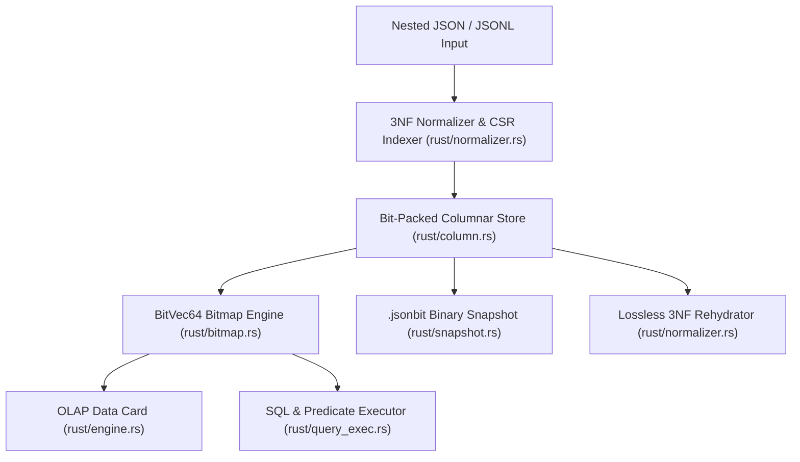
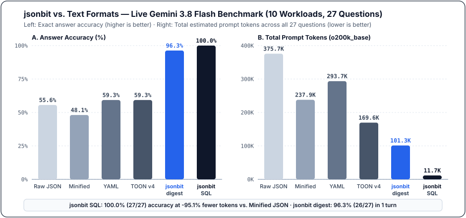
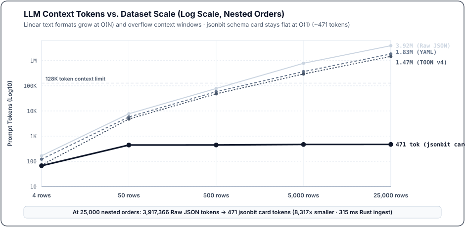

# jsonbit

[](https://github.com/prathikmurugan/jsonbit/actions/workflows/ci.yml)
[](https://crates.io/crates/jsonbit)
[](https://pypi.org/project/jsonbit/)
[](https://www.npmjs.com/package/@jsonbit/core)
[](./rust/mcp.rs)
[](./LICENSE)

**JsonBit compacts nested JSON before it reaches your LLM.** Send a compact digest in one prompt, or let your agent query the original data locally via SQL/MCP and read only the results it needs.

```bash
pip install jsonbit
jsonbit digest path/to/your-file.json
```

Pass the output to your LLM in place of the raw JSON. *(Rust `cargo`, Node.js `npm`/`npx`, and standalone binaries are listed under [Installation & Setup](#installation--setup).)*

Example output from `jsonbit digest`:

```text
# orders[4](orderId,customer_name,customer_tier,status,total)
@stats: total[sum=619.00,avg=154.75,min=95.50,max=201.00]
ORD-101,Alice,pro,shipped,171.75
ORD-102,Bob,starter,pending,201
ORD-103,Cara,pro,shipped,95.5
ORD-104,Dan,pro,shipped,150.75
# orders_items[6] -> orders (sku,qty,price)
@stats: qty[sum=15,avg=2.5,min=1(n=1),max=4] price[sum=246.25,avg=41.04,min=10.50,max=74.50]
0:USB-C,2,10.5|MOUSE,3,50.25
1:MOUSE,4,50.25
2:HUB-4,1,74.5|USB-C,2,10.5
3:MOUSE,3,50.25
```

| Workflow | Command / MCP Tool | Best For | Fidelity & Guarantees |
| :--- | :--- | :--- | :--- |
| **1-Turn Compaction** | `jsonbit digest` / `olap_digest` | Single-prompt LLM calls & holistic summaries where the model needs every row. | Compact LLM text view containing all rows, escaped delimiters, hoisted child tables, and precomputed stats *(rounded averages are approximate)*. |
| **Agentic Local Querying** | `jsonbit card` + `sql` / `olap_load` + `olap_sql` | Coding agents (OpenCode, Claude Code, Cursor) querying medium/large `.json` or `.jsonl` files. | Emits a compact schema and statistics summary (independent of row count); runs exact read-only SQL & `BitVec64` filters locally in microseconds. |
| **Binary Storage** | `jsonbit pack` / `jsonbit rehydrate` | Archiving or caching normalized `.jsonbit` snapshots on disk (`-80.6%` vs. minified JSON on `W1`–`W10`). | Lossless round-trip verified across all 33 benchmark/adversarial datasets and unit tests (preserving nulls, colliding keys, and `u64 > i64::MAX`). |

---

## Table of Contents

- [Installation & Setup](#installation--setup)
- [Agent Integrations (OpenCode, Claude Code, Codex, Cursor)](#agent-integrations)
- [CLI Reference](#cli-reference)
- [Architecture](#architecture)
- [Benchmarks](#benchmarks)
- [License](#license)

---

## Installation & Setup

Install the pre-built native `jsonbit` binary using your preferred package manager (no Rust compiler required for Python or Node.js):

### Python (`pip` / `uv`) — *Includes native CLI + Python SDK*
```bash
pip install jsonbit
```

### Rust (`cargo`)
```bash
cargo install jsonbit
```

### Node.js (`npm` / `npx`) — *Includes native CLI + TypeScript SDK*
```bash
npm install -g @jsonbit/core
# or run directly without global install:
npx @jsonbit/core --help
```

### Pre-Built Binaries & Building from Source
Standalone binaries for Linux (`x64`, `arm64`), macOS (`arm64`, `x64`), and Windows (`x64`) are attached to every [GitHub Release](https://github.com/prathikmurugan/jsonbit/releases).

To build from source (requires Rust `1.75+`):
```bash
git clone https://github.com/prathikmurugan/jsonbit.git
cd jsonbit
cargo install --path .
```

Verify installation:
```bash
jsonbit --version
```

---

## Agent Integrations

`jsonbit` includes a built-in stdio JSON-RPC 2.0 MCP server (`jsonbit mcp`) with zero external runtime dependencies. It exposes five tools: `olap_load`, `olap_digest`, `olap_ask`, `olap_sql`, and `olap_rehydrate`.

### OpenCode (`opencode.json`)

Add the following to `opencode.json` in your project root (or globally in `~/.config/opencode/opencode.json`):

```json
{
  "$schema": "https://opencode.ai/config.json",
  "mcp": {
    "jsonbit": {
      "type": "local",
      "command": ["jsonbit", "mcp"],
      "enabled": true
    }
  }
}
```

### Claude Code (`.mcp.json` or CLI)

Register via the Claude Code CLI:

```bash
claude mcp add jsonbit -- jsonbit mcp
```

Or include in `.mcp.json`:

```json
{
  "mcpServers": {
    "jsonbit": {
      "command": "jsonbit",
      "args": ["mcp"]
    }
  }
}
```

### Cursor & Windsurf

Add the `.mcp.json` configuration above to `.cursor/mcp.json` or `~/.codeium/windsurf/mcp_config.json`.

### OpenAI Codex CLI (`AGENTS.md`)

Codex and terminal agents automatically read [`AGENTS.md`](./AGENTS.md) in the repository root to invoke `jsonbit` via CLI or MCP when inspecting `.json`, `.jsonl`, or `.jsonbit` files.

---

## CLI Reference

| Command | Arguments | Description |
| :--- | :--- | :--- |
| `jsonbit card` | `<file.json\|.jsonl\|.jsonbit>` | Prints the compact 3NF schema and statistics summary (independent of row count) plus storage compression stats. |
| `jsonbit digest` | `<file.json\|.jsonl\|.jsonbit>` | Prints the 1-Turn Factorized 3NF Holistic Digest (all rows, hoisted child tables, and precomputed summary stats). |
| `jsonbit ask` | `<file> "<question>"` | Evaluates a question against the bitmap index and prints the verified context slice. |
| `jsonbit answer` | `<file> "<question>"` | Evaluates a question and prints only the scalar answer value. |
| `jsonbit sql` | `<file> "<SELECT ...>"` | Executes a read-only SQL query against the 3NF columnar store (`WHERE`, `IN`, `BETWEEN`, `LIKE`, `GROUP BY`, `ORDER BY`, `LIMIT`, `OFFSET`, CSR `JOIN`). |
| `jsonbit pack` | `<input.json> <output.jsonbit>` | Serializes the bit-packed 3NF tables into a binary `.jsonbit` snapshot. |
| `jsonbit rehydrate` | `<file.json\|.jsonl\|.jsonbit>` | Reconstructs and prints the original nested JSON document. |
| `jsonbit mcp` | *(none)* | Starts the concurrent stdio JSON-RPC 2.0 MCP server (`olap_load`, `olap_digest`, `olap_ask`, `olap_sql`, `olap_rehydrate`). |

<details>
<summary><strong>Programmatic SDK Usage (Python, TypeScript, Rust)</strong></summary>

#### Python (`pip install jsonbit`)
```python
from jsonbit import JsonBit

with JsonBit("benchmarks/data/github-repos.json") as olap:
    card = olap.card()
    ans = olap.answer("How many repositories have more than 150000 stars and more than 30000 forks?")
    rows = olap.sql("SELECT defaultBranch, COUNT(*) AS cnt FROM records GROUP BY defaultBranch ORDER BY cnt DESC")
    olap.pack("repos.jsonbit")
```

#### TypeScript / Node.js (`@jsonbit/core`)
```ts
import { JsonBit, rehydrateFrom3NF } from '@jsonbit/core'

const engine = JsonBit.from(jsonData)
const card = engine.getDataCard().text
const rows = engine.sql(`SELECT orderId, customer.name, total FROM orders WHERE total > 500`)
const original = rehydrateFrom3NF(engine)
engine.close()
```

#### Rust Library (`cargo add jsonbit`)
```rust
use jsonbit::{execute_sql, JsonBitEngine};

let engine = JsonBitEngine::from_json(&serde_json::from_str(raw_json)?);
let card = engine.data_card();
let rows = execute_sql(&engine, "SELECT department, COUNT(*) AS cnt FROM employees GROUP BY department")?;
let restored = engine.rehydrate();
```

</details>

---

## Architecture



### Storage Layout (`rust/column.rs` & `rust/normalizer.rs`)

1. **`ForIntColumn` (Frame-of-Reference Integers):** Computes `[min_val, max_val]` per column and packs unsigned deltas `val - min_val` into `ceil(log2(max_val - min_val + 1))` bits per row inside a `Vec<u64>` buffer. Column headers store `sum`, `min`, `max`, and `non_null_count` for `O(1)` unfiltered aggregations.
2. **`DictStringColumn` (Dictionary + Inverted Bitmaps):** Interns unique strings into a string arena, bit-packs dictionary IDs into `ceil(log2(|D|))` bits per row, and builds a 64-bit word-aligned `BitVec64` inverted index per category (`|D| <= 64`) for `O(1)` equality lookups and `POPCNT` frequency histograms.
3. **`BoolBitmapColumn` (1-Bit Booleans):** Packs 64 boolean values into each `u64` word alongside a 1-bit validity mask.
4. **CSR 1-to-Many Join Index:** Child arrays (e.g., `orders[].items[]`) are normalized into child tables with a contiguous `csr_offsets: Vec<u32>` array mapping each parent row `i` to its child slice `csr_offsets[i]..csr_offsets[i + 1]`.

---

## Benchmarks

All benchmarks execute directly against the compiled Pure-Rust `jsonbit` binary (`target/release/jsonbit`).

### 1. Live `gemini-3.8-flash` Evaluation Across 10 Real-World Workloads (27 Questions)

Evaluates `Raw JSON`, `Minified JSON`, `YAML`, `TOON` (`@toon-format/toon`), and `jsonbit` across 10 production workloads (`W1`–`W10`), including flat tables, 1-to-Many e-commerce orders, sparse `.jsonl` OpenTelemetry logs with free-text messages, singleton Kubernetes configs, IAM primitive arrays, wide 30-column tables, and multi-byte UTF-8 financial ledgers. Across the 27 questions, single-prompt `jsonbit digest` uses **57.4% fewer estimated tokens than Minified JSON** (`101,302` vs. `237,891`) with **26/27** vs. **13/27** accuracy:



| Format / Tool | Mode | Live `gemini-3.8-flash` Accuracy | Est. Tokens (`o200k_base`) | Reduction vs. Minified JSON | Reduction vs. Raw JSON |
| :--- | :--- | ---: | ---: | ---: | ---: |
| **Raw JSON (Pretty)** | 1-Turn Full Text | 55.6% (15/27) | 375,713 | +57.9% | — |
| **Minified JSON** | 1-Turn Full Text | 48.1% (13/27) | 237,891 | — | -36.7% |
| **YAML** | 1-Turn Full Text | 59.3% (16/27) | 293,690 | +23.5% | -21.8% |
| **`TOON` v4 (`@toon-format/toon`)** | 1-Turn Full Text | 59.3% (16/27) | 169,627 | -28.7% | -54.9% |
| **`jsonbit` Holistic Digest (`olap_digest`)** | **1-Turn (All Rows + Summary Stats)** | **96.3% (26/27)** | **101,302** | **-57.4%** | **-73.0%** |

*Agentic local-query comparison (separate workflow — schema summary + Rust SQL execution, not a full-row text encoding):*

| Tool | Mode | Live `gemini-3.8-flash` Accuracy | Est. Tokens (`o200k_base`) | Reduction vs. Minified JSON |
| :--- | :--- | ---: | ---: | ---: |
| **`jsonbit` Schema Card + SQL (`olap_load` + `olap_sql`)** | **Agentic Schema Summary + Local Rust SQL** | **100.0% (27/27)** | **11,729** | **-95.1%** |

> *Methodology note: Token counts above are `gpt-tokenizer` (`o200k_base`) estimates for reproducible cross-format comparison; the `jsonbit` SQL path total includes the schema summary prompt plus generated SQL query tokens.*

#### Single-Prompt Summary Accuracy (`W3`, `W4`, `W5`, `W10`)

For qualitative tasks where the LLM must read all records in a single turn and write a multi-fact executive summary (naming all departments, products, microservice failure messages, and international counterparties across `W3`, `W4`, `W5`, and `W10`):

| Holistic Synthesis Task | `TOON` v4 Facts Preserved | `jsonbit digest` Facts Preserved | `TOON` Tokens | `jsonbit digest` Tokens | Token Savings vs. `TOON` |
| :--- | ---: | ---: | ---: | ---: | ---: |
| `H1` — HR Directory Executive Summary | 8 / 9 | **9 / 9 (100%)** | 4,881 | **4,372** | **-10.4%** |
| `H2` — E-Commerce Catalog & Orders Summary | 8 / 8 | **8 / 8 (100%)** | 15,405 | **6,933** | **-55.0%** |
| `H3` — Production Incident Log Triage Report | 9 / 9 | **9 / 9 (100%)** | 13,665 | **4,169** | **-69.5%** |
| `H4` — International Settlement Ledger Summary | 2 / 6 | **6 / 6 (100%)** | 3,781 | **2,403** | **-36.4%** |
| **Total Across All Qualitative Summaries** | **27 / 32 (84.4%)** | **32 / 32 (100.0%)** | **37,732** | **17,877** | **-52.6%** |

### 2. Token Scaling Curve (`4` $\rightarrow$ `25,000` Nested Orders)

While linear text encodings (`Raw JSON`, `Minified JSON`, `YAML`, `TOON`) scale at $O(N)$ with row count and exceed LLM context windows at scale, `jsonbit` maintains an $O(1)$ prompt footprint (`~67–473` tokens):



| Dataset Scale (Nested Orders) | Raw JSON (Tokens) | YAML (Tokens) | `TOON` v4 (Tokens) | `jsonbit` Rust Card (Tokens) | Rust Ingest Time |
| :--- | ---: | ---: | ---: | ---: | ---: |
| **4 rows** *(Tiny API Payload)* | 166 | 122 | 71 | **67** | 0.04 ms |
| **50 rows** *(~150 line items)* | 7,780 | 5,801 | 4,783 | **445** | 0.51 ms |
| **500 rows** *(~1,500 line items)* | 78,115 | 58,244 | 47,983 | **447** | 3.99 ms |
| **5,000 rows** *(~15,000 line items)* | 783,443 | 366,356 | 293,972 | **470** | 55.56 ms |
| **25,000 rows** *(~75,000 line items)* | 3,917,366 | 1,831,843 | 1,469,911 | **471** | 315.13 ms |

> *Note: For `5,000`- and `25,000`-row payloads (>2 MB), `YAML` and `TOON` token counts are ratio-extrapolated from the `500`-row exact encoding; `jsonbit` card tokens and Rust ingest times are measured directly on the full dataset.*

### 3. Memory Footprint & Query Speed (`Pure-Rust jsonbit` vs. `jq` CLI)


| Workload | Category | Minified JSON | Rust Column-Store (RAM) | Pretty JSON (Tok) | `TOON` (100% Rows) | `jsonbit digest` (100% Rows) | `jsonbit card` ($O(1)$) | 3NF Lossless |
| :--- | :--- | ---: | ---: | ---: | ---: | ---: | ---: | :---: |
| `W1-tiny-api-response` | Tiny Payload (<500B) | 0.3 KB | **0.1 KB** | 166 | 71 | **67 (-5.6%)** | **67** | PASS |
| `W2-singleton-k8s-config` | Singleton Config Tree | 0.3 KB | **0.2 KB** | 167 | 131 | **110 (-16.0%)** | **110** | PASS |
| `W3-hr-payroll-directory` | Tabular (200 rows) | 28.4 KB | **4.5 KB** | 14,064 | 4,847 | **4,327 (-10.7%)** | **270** | PASS |
| `W4-ecommerce-orders-1toN` | 1-to-Many (150 orders) | 48.3 KB | **4.5 KB** | 25,466 | 15,372 | **6,892 (-55.2%)** | **470** | PASS |
| `W5-otel-production-logs` | Sparse `.jsonl` + Free-Text | 44.4 KB | **4.7 KB** | 17,439 | 13,632 | **4,132 (-69.7%)** | **224** | PASS |
| `W6-github-repos-metrics` | High-Card + Ranges | 28.6 KB | **3.4 KB** | 14,829 | 5,364 | **4,414 (-17.7%)** | **307** | PASS |
| `W7-stripe-dispute-webhooks` | Financial Webhooks | 28.9 KB | **3.1 KB** | 14,333 | 4,104 | **4,341 (+5.8%)** | **248** | PASS |
| `W8-iam-primitive-arrays` | Primitive Arrays | 14.4 KB | **1.6 KB** | 7,185 | 4,810 | **1,257 (-73.9%)** | **162** | PASS |
| `W9-wide-enterprise-crm` | Wide Table (30 cols) | 68.6 KB | **5.7 KB** | 40,779 | 9,806 | **9,549 (-2.6%)** | **1,134** | PASS |
| `W10-unicode-financial-ledger` | UTF-8, Nulls & Zeroes | 18.4 KB | **2.9 KB** | 9,550 | 3,750 | **2,364 (-37.0%)** | **241** | PASS |
| **Total (10 Workloads)** | **All Categories** | **280.6 KB** | **30.6 KB (-89.1%)** | **143,978** | **61,887** | **37,453 (-39.5%)** | **3,233 (-94.8%)** | **10/10 PASS** |

> *Workload breakdown: On tiny payloads (`W1`), singleton configs (`W2`), financial webhooks with heavy quoting (`W7`, `+5.8%`), and wide flat 30-column tables (`W9`, `-2.6%`), 1-turn `digest` is close to `TOON`. The largest reductions come from nested 1-to-Many hierarchies (`W4`, `-55.2%`), sparse `.jsonl` logs (`W5`, `-69.7%`), and primitive arrays (`W8`, `-73.8%`), where 3NF hoisting and prefix/dictionary factoring eliminate repeated structure.*

- **Storage Accounting (`W1`–`W10`):**
  - **In-memory bit-packed column store:** `280.6 KB` (Minified JSON) $\rightarrow$ **`30.6 KB` (`-89.1%`)**
  - **Serialized on-disk `.jsonbit` snapshots (`jsonbit pack`):** `280.6 KB` (Minified JSON) / `427.7 KB` (raw files) $\rightarrow$ **`54.3 KB` (`-80.6%` vs. Minified JSON, `-87.3%` vs. raw files)**
- **Query Latency (Warm In-Memory Rust Engine vs. Cold `jq` CLI Subprocess):**
  - `jq` CLI (`stedolan/jq`, cold subprocess including startup & JSON parsing): `6,545.3 µs` average per query
  - `jsonbit` Pure-Rust SQL (`execute_sql`, warm in-memory engine): **`6.8 µs` average per query**
  - `jsonbit` Pure-Rust Bitmap Slice (`query_slice`, warm in-memory engine): **`19.9 µs` average per query**
- **Standard 8-Dataset Benchmark Suite:**
  - **In-Memory Column-Store Compression:** `1,178,283` bytes (Minified JSON) $\rightarrow$ **`419,661` bytes (`-64.4%`)**, `8/8` (`100%`) lossless 3NF rehydration.
  - **Schema Card Size vs. Full Dataset Text:** `334,046` tokens (`TOON` v4 full text) $\rightarrow$ **`2,536` tokens (`-99.24%`, schema & stats summary only)**.
  - **239-Question Evaluation Accuracy:** `99.16% (237/239)` strict match at **`8.0 µs`** average warm query latency.

### 4. Autonomous Coding Agent Head-to-Head (`OpenCode v1.19.5`)

Evaluated in isolated directories with zero prompt hints and zero `AGENTS.md`/`CLAUDE.md` files (`opencode/big-pickle`) across both standard (bash-enabled) and sandboxed (`bash: "deny"`) agent environments:

| Agent Mode | `jsonbit` MCP (`opencode.json` only) | `TOON` v4 (`toon_encode` / CLI) | Raw JSON |
| :--- | :--- | :--- | :--- |
| **Standard Agent (`6` Scenarios, `18` Runs)** | **6/6 (`88.1s`) · `0` scripts** | 6/6 (`142.8s`) · `awk`/Python parsers | 6/6 (`93.7s`) · Python scripts |
| **Sandboxed Read-Only (`bash: "deny"`, `8` Scenarios)** | **8/8 (`77.7s`)** | 7/8 (`333.8s`) · failed `500`-order sum | 7/8 (`345.4s`) · failed `500`-order sum |

---

## License

[MIT License](./LICENSE).
